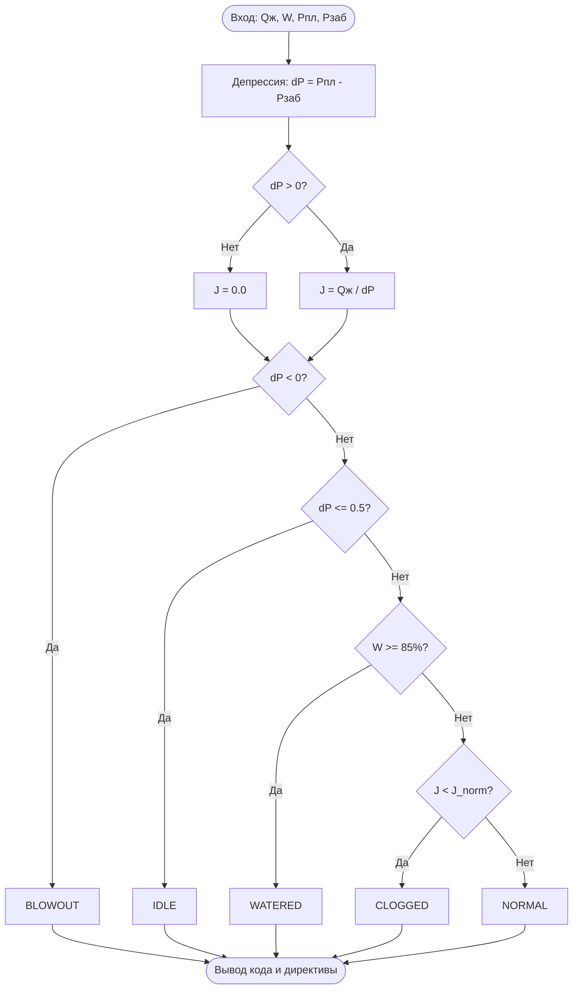

# praktika_pnp
# Практическая работа 1
## Вариант Б. Аварийная диагностика скважины

### 1. Индивидуальные данные

N1 = 12
N2 = 13
N = 12 + 13 = 25

| Показатель | Значение |
|---|---:|
| Дебит жидкости Qж | 60 м³/сут |
| Обводнённость W | 95% |
| Пластовое давление Pпл | 27.0 МПа |
| Забойное давление Pзаб | 16.8 МПа |
| Норматив J_norm | 4.75 |

### 2. Таблица требований

| Функция | Назначение |
|---|---|
| validate_telemetry() | Проверяет допустимые границы четырёх датчиков |
| calc_hydraulics() | Рассчитывает депрессию и продуктивность |
| determine_status_code() | Определяет состояние скважины |
| route_dispatcher_action() | Выдаёт команду диспетчеру через match-case |

### 3. Расчёты

dP = 27.0 - 16.8 = 10.2 МПа
J = 60 / 10.2 = 5.88

### 4. Блок-схема

### 5. Результат

Состояние скважины: WATERED.
Причина: обводнённость составляет 95%, что превышает критическое значение 85%.
Команда диспетчеру: проверить водоизоляцию.
