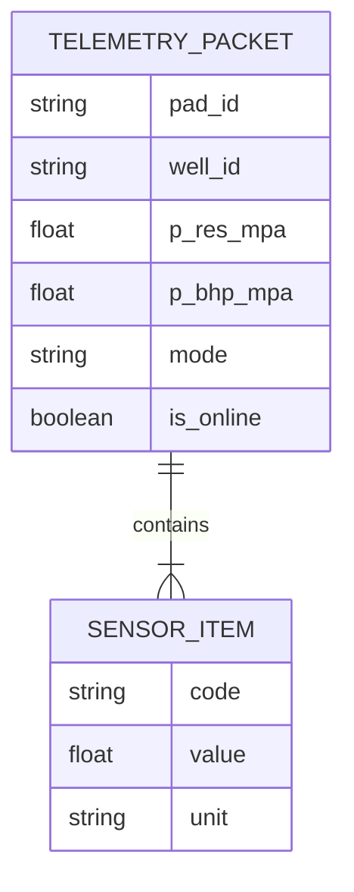

# Практическая работа №2
## Этап 1. Вариант Б
### Пакет телеметрии куста скважин с массивом датчиков

**Участники:** Файрушина Лара и Латыпова Лина

**Индивидуальные номера:**
- N1 = 12
- N2 = 13
- N = N1 + N2 = 25

---

## 1. Расчёт индивидуальных параметров

Для варианта Б используются следующие формулы:

| Параметр | Формула | Результат |
|---|---|---|
| pad_id | PAD-(10 + N % 20) | PAD-15 |
| well_id | W-(200 + N) | W-225 |
| p_res_mpa | 22.0 + 0.5 * (N % 20) | 24.5 |
| p_bhp_mpa | 12.0 + 0.4 * (N % 20) | 14.0 |
| temp_c | 45.0 + 1.5 * (N % 15) | 52.5 |
| rate_m3d | 60.0 + 4.0 * (N % 25) | 60.0 |

## 2. Data Dictionary

| Поле | Описание | Тип Python | Тип JSON | Обязательное |
|---|---|---|---|---|
| pad_id | Идентификатор куста | str | string | Да |
| well_id | Идентификатор скважины | str | string | Да |
| p_res_mpa | Пластовое давление, МПа | float | number | Да |
| p_bhp_mpa | Забойное давление, МПа | float | number | Да |
| mode | Режим работы скважины | str | string | Да |
| is_online | Наличие связи со станцией | bool | boolean | Да |
| sensors | Массив датчиков | list | array | Да |
| sensors[].code | Код датчика | str | string | Да |
| sensors[].value | Значение показания | float | number | Да |
| sensors[].unit | Единица измерения | str | string | Да |

## 3. ER-диаграмма

